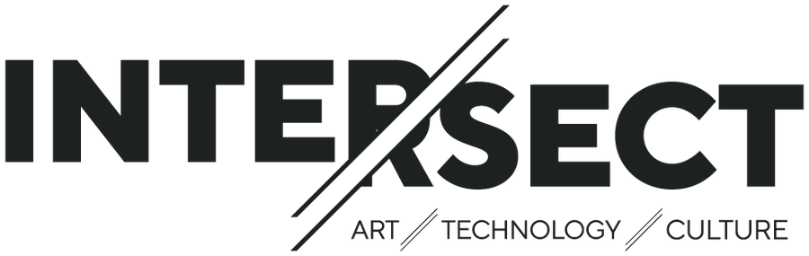

<div align="center">



# INTERSECT production office

</div>

**Events at the edge.** Culture-first production, run like infrastructure: an open-source, private and free production office for [Logos Basecamp](https://logos.co), open to anyone at any level of event production, curation or event management experience. It holds lessons learnt over 20-plus years, across geographies and event formats, from the INTERSECT team ([intersectlive.io](https://www.intersectlive.io)).

What's new in 0.3.0:

- **INTERSECT look.** White and grey sheets, black and grey type, Volt for action, Lean for selection and Heat only for alarms, set in Space Grotesk and Space Mono (bundled in `src/qml/fonts`, SIL OFL).
- **Home and showreel.** A Home view with the INTERSECT story and a video carousel of previous events (four portfolio films bundled in `src/qml/media`). Add more with **+ Add a portfolio video**.
- **Intersect Archive on Logos Storage.** Every module page has a Files block, and each event has an Intersect Archive page that lists every file by module. Files are copied into a private vault in the module's data folder and stored on your own Logos Storage node with `advertise=false`, so they are never announced to the DHT or served to peers. The CID stays in `archive.json` beside `events.json`.
- **Showreel module.** Every video archived for an event, in one carousel.

Each event gets a format-specific template — milestones counted back from show day, budget lines, venue checks, permits, comms waves, vendors, risks and wrap tasks — and a set of modules you can switch on or off.

| Format | Modules switched on |
| --- | --- |
| Festival | Brief, Timeline, Team, Budget, Sponsors, Programme, Immersive & art, Venue, Comms, Vendors, Run of show, Risks, Wrap |
| Conference | + Call for speakers, Registration & tickets, Exhibitors & expo, Travel |
| Corporate event | Stakeholders & approvals, Guest list & RSVPs, Travel, Programme, Venue, Vendors, Run of show, Risks, Wrap |
| Brand activation | Sponsors, Experience design, Immersive & art, Staffing & ambassadors, Data & measurement, Samples & inventory, … |
| Brand experience / pop-up | Activation modules + Stakeholders & approvals, Tour & locations |
| Immersive / art / cultural | Programme, Immersive & art, Venue, Comms, Vendors, Run of show, Risks, Wrap |
| Hackathon / developer event | Tracks & challenges, Teams & registrations, Judging & scoring, Prizes & bounties, Mentor schedule |
| Virtual / hybrid event | Streaming & platform, Time-zone schedule, Online engagement, Recording & VOD, Registration |
| Pop-up village / residency | Participants & applications, Accommodation & rooms, Meals & dietary, Daily programme, House rules & arrivals |
| Travel / walking / touring | Route & stages, Transport, Lodging per stop, Participant roster, Film & content crew |
| Community meetup / salon series | Session calendar & host rotation, Members & attendance, Venue partners |
| Fundraising / benefit event | Donors & pledges, Auction & raffle, Donation channels, Impact reporting, Guest list |

50 built-in modules in all, and every format also gets Brief, Timeline, Team, Budget and Wrap. Any module can be added to any event from its Overview.

### Custom modules

**+ Custom module** (on the Overview and in the sidebar) opens a builder: name the module, then add columns as Text, Long text, Number, Money, Date, Time, Status, Checkbox or a Choice list. A custom module behaves like a built-in one. Number and money columns get totals, status and checkbox columns count toward progress, and rows save with the event. Use **Edit columns** on the module to change it later. Once you've built a module for one event, every other event's Overview offers it ("from …"), so you can reuse the columns without their rows.

## What's here

One `ui_qml` module with a C++ backend that runs as a core module (`"backend": "module"`), shipped as a single `.lgx`.

```
metadata.json                  module definition (ui_qml, universal interface, backend: module, depends on storage_module)
flake.nix                      builds with logos-module-builder's mkLogosQmlModule
CMakeLists.txt                 compiles the backend; repc runs on the .rep
src/production_office.rep      view ↔ backend contract (SLOTs + PROPs)
src/production_office_backend.{h,cpp}
                               storage: one JSON document per event in events.json
src/production_office_archive.cpp
                               Intersect Archive: private vault + Logos Storage (advertise=false)
src/qml/VideoStage.qml         video player (Qt Multimedia); falls back to poster + "Open video"
src/qml/FilePicker.qml         system file dialogs (QtQuick.Dialogs); falls back to a path field
src/qml/brand, fonts, media    INTERSECT logo, Space Grotesk / Space Mono, portfolio videos
src/qml/Main.qml               the view: sidebar, overview, brief, generic table editor
src/qml/templates.js           formats, modules, table schemas, template generator, custom modules
                               (shared with the web version: see web/)
tests/ui-tests.mjs             Basecamp UI tests (nix run .#ui-tests)
tests/harness.py + TestRunner.qml
                               headless Qt test of the view with a mock backend
web/                           the web version's markup and script, built on templates.js
tools/build-web.py             injects templates.js into the web version
```

### How the pieces fit

- **The view owns the schema.** `templates.js` defines every format, module and table column. The backend stores each event as an opaque JSON document, so adding a module or a column never needs a C++ change. Custom modules are stored inside the event (`custom` holds their columns, and each module's rows sit under its own `cm-…` key).
- **The backend owns storage.** `listEvents`, `saveEvent`, `deleteEvent`, `exportAll` and `importAll` read and write `events.json` in the module's data folder (`instancePersistencePath()`). Writes go through `QSaveFile`, so a crash never leaves a half-written file, and the last good copy is kept as `events.backup.json`.
- **Edits save themselves.** The view debounces changes (0.7 s) and sends the whole event to `saveEvent`. The `status` PROP shows "Saved 14:02" or the error.
- **Backup and restore** are in the sidebar: copy every event as JSON, or paste a backup to bring events back on another machine.

## Prerequisites

- [Nix](https://nixos.org/download/) with flakes enabled (`experimental-features = nix-command flakes` in `~/.config/nix/nix.conf`)
- [Logos Basecamp](https://github.com/logos-co/logos-basecamp/releases) with module-backend support

## Build and run

```bash
git init && git add -A            # Nix only sees files tracked by git
nix flake update                  # first time only
nix run .                         # opens Production Office in Basecamp's standalone mode
```

The first build downloads Qt and the Logos SDK, so it takes a while; later builds take seconds.

To package it for installing in Basecamp:

```bash
nix build '.#lgx-portable' --out-link result-portable
```

Then in Basecamp open **Modules → Install LGX Package** and pick `result-portable/*.lgx`.

### Iterating on the view

```bash
nix build .#ui-dev
./result/bin/run-logos-standalone-ui   # from the repo root; QML edits reload on save
```

## Tests

```bash
nix run .#ui-tests                                       # inside real Basecamp, headless
pip install PySide6                                      # or, without Nix:
QT_QPA_PLATFORM=offscreen python3 tests/harness.py       # 25 checks + screenshots in tests/out/
QT_QPA_PLATFORM=offscreen python3 tests/harness.py --preview
```

The Python harness loads the real `Main.qml` with a stand-in for Basecamp's `logos` bridge and an in-memory backend that implements the same `.rep` contract. In 54 checks it creates events in every format, edits cells, adds and deletes rows, switches formats, hides and adds modules, builds, edits, reuses and deletes a custom module, backs up, deletes and restores, and checks what reaches the backend.

## Web version

The same app also runs as a web page (a claude.ai artifact with a shared store). It is built from the same `templates.js`, so formats, modules and custom modules stay identical in both:

```bash
python3 tools/build-web.py production-office.html
```

## Releasing

Bump `version` in `metadata.json`, then publish the `.lgx` the same way as the [logos-todo](https://github.com/hackyguru/logos-todo) example (its `_release-module.yml` workflow uses `logos-co/logos-modules-release-action` and a `LOGOS_SIGNING_KEY` secret).

## Before the first build

The C++ backend, including the new archive code, has not yet been compiled: the environment it was written in could not fetch Qt or the Logos SDK. The storage calls follow `logos-storage-module` v3's header (`uploadUrl(path, chunkSize, advertise)`, `downloadToUrl(...)`, `remove(cid)`, the `storageUploadDone` event) and the typed `modules().storage_module` wrapper the builder generates. If the first `nix build` reports an error in `production_office_archive.cpp`, the wrapper's exact Qt types are the place to look.

The portfolio videos add about 43 MB to the `.lgx`.

## Next steps

- **Team sync over Logos Messaging.** Add `delivery_module` as a dependency and broadcast each saved event on a shared content topic (last-writer-wins by `updatedAt`), so a production team sees each other's changes. The [logos-shared-color](https://github.com/hackyguru/logos-shared-color) example shows the pattern.
- **Files over Logos Storage.** Attach riders, contracts and site plans to rows through `storage_module`, as in [logos-filesharing](https://github.com/hackyguru/logos-filesharing).
